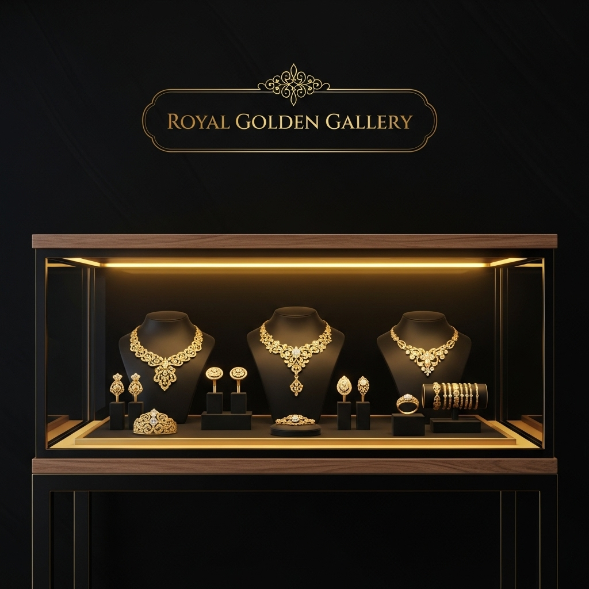
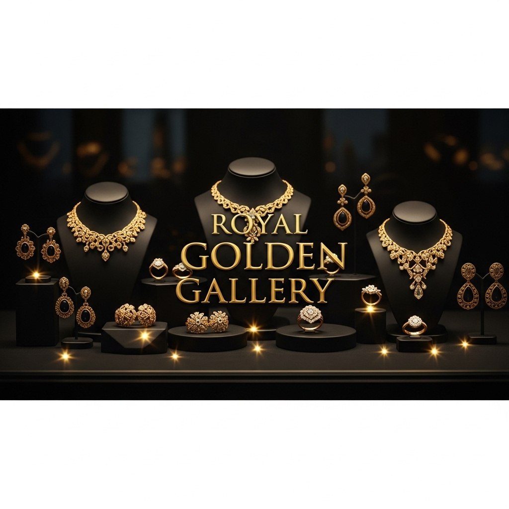
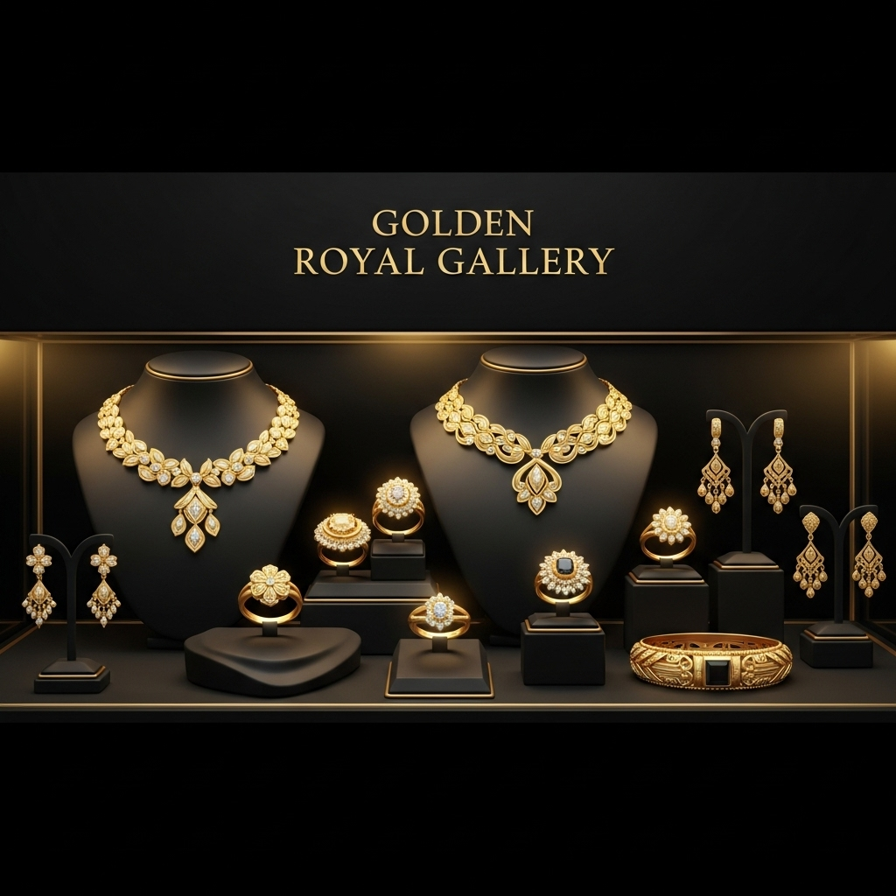
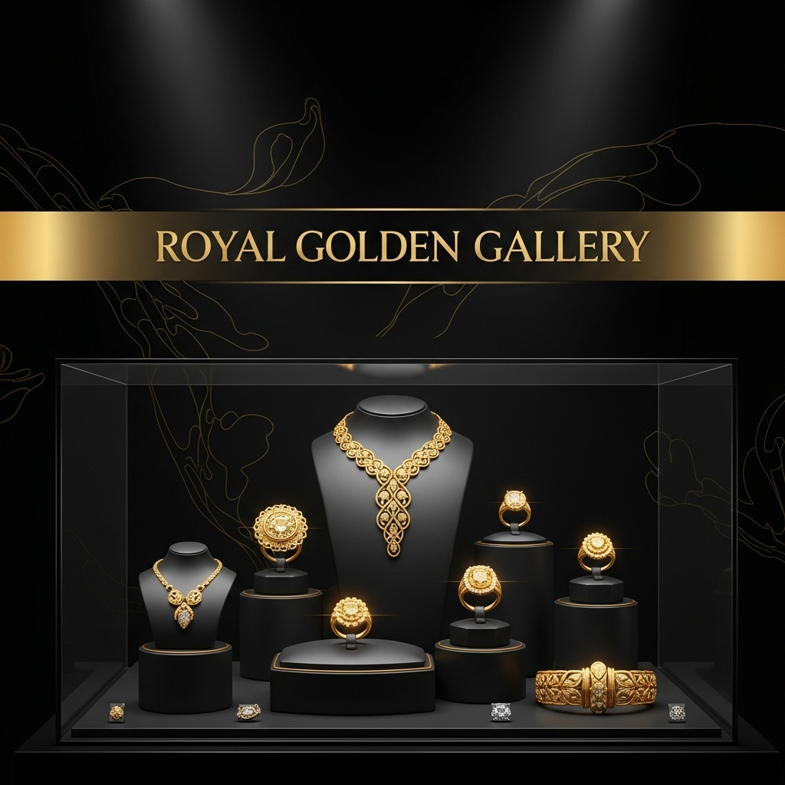
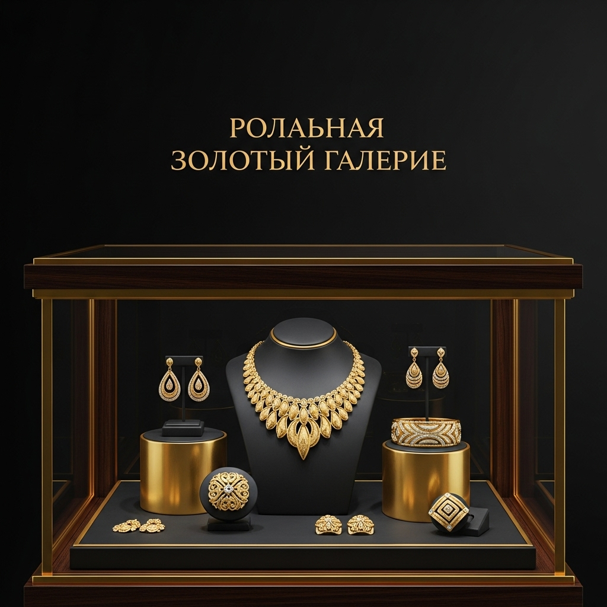
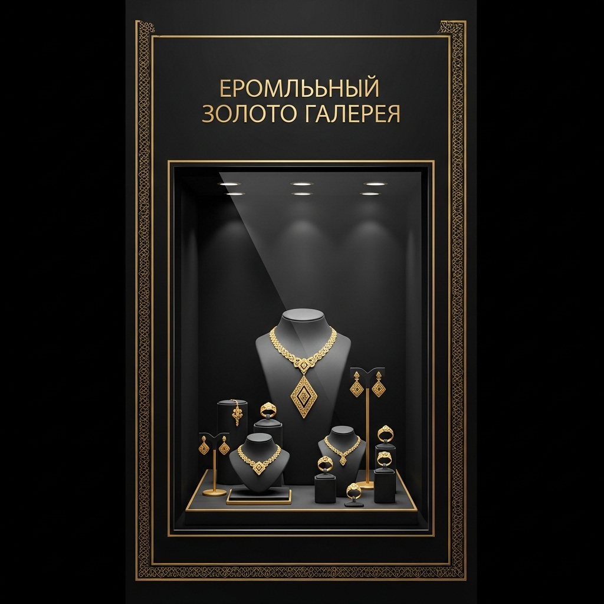

<div align="center">



# 💎 گالری طلای سلطنتی

### ✨ Royal Gold Gallery ✨

**وب‌سایت نمایش و فروش طلا و جواهرات با تم لوکس مشکی-طلایی**


-D4AF37?style=for-the-badge&logoColor=white)


</div>

---

## 📖 درباره پروژه

**گالری طلای سلطنتی** یک وب‌سایت تک‌صفحه‌ای (Single Page) تمام‌فارسی و راست‌چین است که برای نمایش و فروش طلا و جواهرات لوکس طراحی شده است. این پروژه با هدف خلق تجربه‌ای لوکس و سلطنتی ساخته شده؛ ترکیبی از تم مشکی عمیق و طلای براق، افکت‌های شیشه‌ای (Glassmorphism)، انیمیشن‌های نرم اسکرول و تایپوگرافی وزیرمتن که حس اعتماد و اصالت را به بازدیدکننده منتقل می‌کند.

تمام بخش‌های سایت در یک فایل `index.html` جمع شده‌اند تا استقرار آن ساده‌ترین حالت ممکن باشد — کافیست فایل را روی هر هاستی قرار دهید.

---

## 🖼️ پیش‌نمایش

<div align="center">

| ویترین اصلی | کلکسیون طلایی |
|:---:|:---:|
|  |  |

| گالری سلطنتی | ویترین نورپردازی‌شده |
|:---:|:---:|
|  |  |



</div>

---

## ⚡ امکانات

- 🖤 **تم لوکس مشکی-طلایی** — پالت رنگی حرفه‌ای با متغیرهای CSS (طلای براق `#D4AF37` روی مشکی عمیق)
- 🪟 **افکت شیشه‌ای (Glassmorphism)** — نوار ناوبری و سکشن‌ها با پس‌زمینه مات و محو
- ✨ **انیمیشن درخشش طلا** — گرادیان متحرک روی تیترها (Gold Shine)
- 📜 **انیمیشن نمایش هنگام اسکرول** — بخش‌ها به‌صورت تدریجی ظاهر می‌شوند (`reveal-fade`)
- 🔤 **فونت وزیرمتن** — تایپوگرافی استاندارد و زیبای فارسی با وزن‌های متنوع
- 🔢 **پشتیبانی از اعداد فارسی** — با تنظیمات فونت پیشرفته
- 📱 **کاملاً ریسپانسیو** — سازگار با موبایل، تبلت و دسکتاپ
- 🧭 **ناوبری چسبان (Sticky Navbar)** — با افکت تغییر هنگام اسکرول و لینک‌های نرم (Smooth Scroll)

---

## 🧩 بخش‌های سایت

| بخش | توضیحات |
|------|----------|
| 🏠 **صفحه اصلی** | هیرو تام‌صفحه با عنوان درخشان و دکمه‌های اقدام |
| 💍 **کلکسیون‌ها** | سه کلکسیون: سلطنتی، عروس و مدرن |
| 👑 **محصولات ویژه** | گردنبند الماس آبی، انگشتر زمرد کلمبیا، دستبند طلای ایتالیایی، گوشواره الماس تراش برلیان |
| 🎁 **بخش اختصاصی** | معرفی سرویس‌های ویژه گالری |
| 🛠️ **خدمات** | طراحی سفارشی، ضمانت اصالت، ارسال امن، تعمیرات تخصصی، مشاوره رایگان، بازخرید تضمینی |
| 📈 **سرمایه‌گذاری** | معرفی طلا به‌عنوان یک دارایی امن |
| 👤 **درباره ما** | داستان و اعتبار گالری |
| 📞 **تماس با ما** | تلفن، ایمیل، آدرس، ساعات کاری و فرم تماس |

---

## 🛠️ تکنولوژی‌ها

| ابزار | کاربرد |
|--------|----------|
| **HTML5** | ساختار تک‌فایلی سایت |
| **Tailwind CSS** | استایل‌دهی (از طریق CDN) |
| **CSS Variables** | مدیریت پالت رنگی مشکی-طلایی |
| **Vazirmatn** | فونت فارسی (Google Fonts) |
| **Font Awesome 6.5** | آیکون‌ها |
| **Vanilla CSS Animations** | انیمیشن‌های درخشش و ظاهرشدن |

---

## 🚀 نحوه اجرا

این پروژه هیچ وابستگی و مرحله نصبی ندارد:

```bash
# ۱) مخزن را کلون کنید
git clone https://github.com/alilotfyarbat/Gold-jewelry-sales-website.git

# ۲) فایل index.html را در مرورگر باز کنید
open index.html        # مک
# یا
start index.html       # ویندوز
```

> 💡 برای استقرار روی GitHub Pages کافیست از منوی **Settings → Pages** شاخه `main` را انتخاب کنید.

---

## 📂 ساختار پروژه

```
Gold-jewelry-sales-website/
├── index.html      # کل سایت (ساختار + استایل + اسکریپت)
├── 0.png           # تصویر ویترین اصلی
├── 1.png           # تصویر کلکسیون طلایی
├── 2.png           # تصویر گالری سلطنتی
├── p3.png          # تصویر ویترین نورپردازی‌شده
├── p4.png          # تصویر برند
├── p5.png          # تصویر برند
└── README.md       # همین فایل
```

---

## 👤 توسعه‌دهنده

<div align="center">

**علی لطفی اربط** — مهندس نرم‌افزار

[](https://github.com/alilotfyarbat)
[](https://alilotfyarbat.ir)

⭐ اگر این پروژه برایتان مفید بود، یک ستاره بدهید! ⭐

</div>
